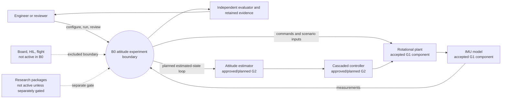
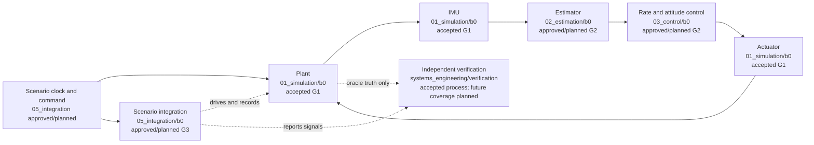
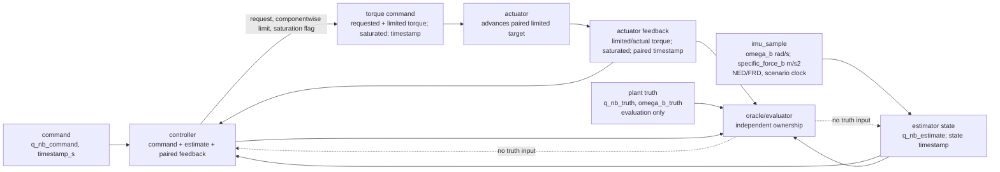
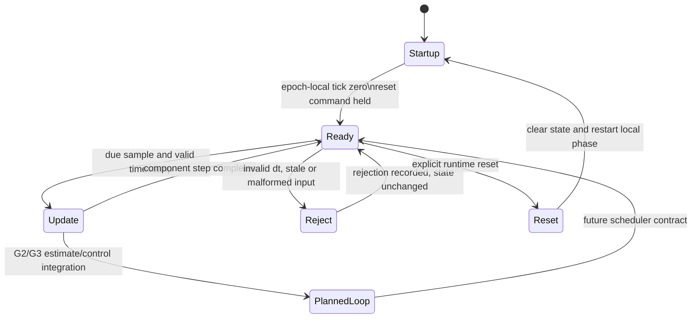
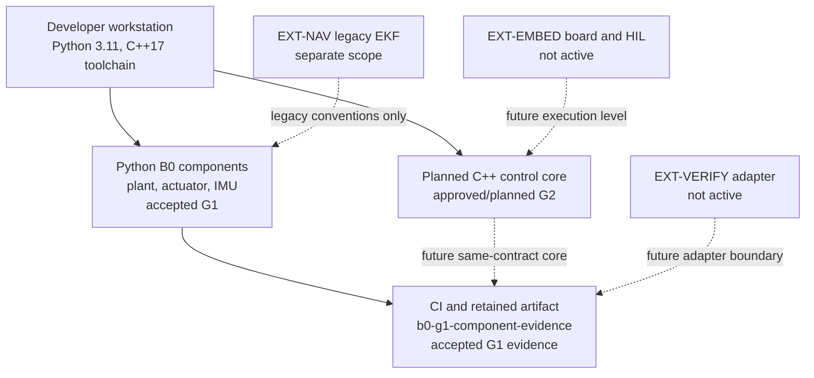

# B0 system views

These five views are the first lightweight systems-engineering model set. Each
view states its identifier, purpose, scope, baseline, sources, and maturity
legend before the editable Mermaid source. Labels marked **accepted** describe
the G0/G1 evidence that exists; **approved/planned** and **not active** are not
implementation claims.

## SE-MODEL-CONTEXT-001 — system context and use

**Purpose:** bound the B0 attitude experiment and show its users and external
dependencies. **Scope/baseline:** B0 v0.2, G0 v2, G1 merged at
`de0006392a4ac6017c4be0b6befa35f1d6cefe0e`. **Sources:**
[project charter](../project_charter.md), [development baseline](../development_baseline.md),
and the G0 operating envelope. **Maturity:** the platform boundary and G0/G1
component scope are accepted; the closed-loop estimator/controller use is
approved/planned until G2/G3.

The planned loop is shown as a boundary relationship, not as a claim that G2 or
G3 is implemented. Hardware, HIL, flight, navigation, learning and papers are
outside this model's active scope.

## SE-MODEL-ARCH-001 — functional and logical allocation

**Purpose:** allocate B0 functions without moving module ownership. **Scope:**
plant, sensor, estimator, control, actuator, integration and independent
verification. **Baseline/sources:** G0 interface contract, G1 component tests,
and [architecture](architecture.md). **Maturity:** Plant, actuator and IMU are
accepted at G1; estimator/control/integration are approved/planned; verification
is an independent responsibility, not a component of the controller.

The dotted truth path terminates at independent verification. It is not an
input path to the estimator or controller.

## SE-MODEL-INTERFACE-001 — interface and data flow

**Purpose:** make the message direction, ownership and truth boundary explicit.
**Scope/baseline:** G0 v2 interface/timing/initialization contracts; no new
thresholds. **Sources:** `05_integration/b0/configs/b0_g0_contract.v2.json`
(`interface_contract`, `timing`, `initialization_contract`) and
[G0 model contract](g0_contract.md). **Maturity:** G0 message semantics are
approved; consuming implementations are accepted only for the G1 components.

All vectors retain SI units, NED/body frame conventions and scalar-first
Hamilton quaternion order. The controller consumes the attitude command,
current estimate and tagged actuator feedback, then produces the requested
torque, its componentwise limited target and the saturation flag in one
controller tick. The controller is the sole limiting authority; the actuator
advances the paired limited target and reports actual/limited torque and the
paired saturation status back to the controller and evaluator. Scenario-clock
timestamps pair samples and feedback. Truth is owned by the plant/evaluator
boundary and is never silently copied into an estimator or controller input.

## SE-MODEL-BEHAVIOR-001 — lifecycle and rejection behavior

**Purpose:** describe the already-contracted startup/reset/rejection ordering
without inventing a scheduler. **Scope/baseline:** G0 timing, reset and invalid
input rules; G1 component reset behavior. **Sources:** G0 v2
`timing`, `initialization_contract`, `acceptance_policy`, and G1 tests.
**Maturity:** startup/reset and input rejection are approved/partially accepted;
the full estimated-state loop is planned for G2/G3.

The `PlannedLoop` state is deliberately future work: G1 does not claim an
estimated-state closed loop. Reset starts a new local epoch; no previous truth,
timestamp or hidden state is reused as an input.

## SE-MODEL-DEPLOY-001 — deployment and extension boundary

**Purpose:** show what can be run today and what remains an extension boundary.
**Scope/baseline:** G1 accepted Python components, development-readiness toolchain,
and the B0 roadmap. **Sources:** G1 evidence/CI and [roadmap](../../docs/roadmap.md).
**Maturity:** Python component execution is accepted; C++ core, board/HIL and
external verification adapters are approved/planned or not active.

No deployment arrow means that a board, HIL loop, flight stack or external
verification suite is currently operational. Those are extension interfaces and
require their own scope, evidence and approval.
